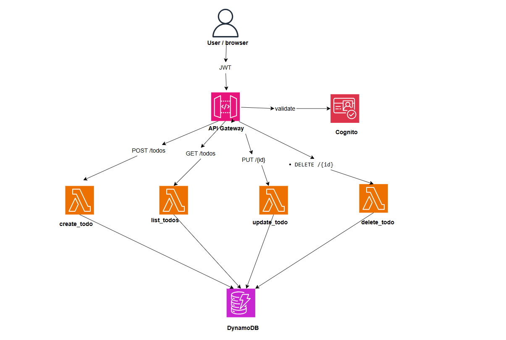

# Serverless To-Do API

A serverless REST API for managing personal to-do items, built with Amazon API Gateway, AWS Lambda, Amazon DynamoDB, and Amazon Cognito. Built as a Manara graduation project (Project 3: Serverless REST API with Cognito Auth, DynamoDB & WAF).

## Architecture



The API has no servers to manage — every component scales automatically and costs nothing when idle.

**Request flow:**
1. A user authenticates against Cognito and receives a JWT.
2. The client sends that JWT in the `Authorization` header on every request.
3. API Gateway validates the JWT against the Cognito User Pool before allowing the request through — invalid or missing tokens are rejected before reaching any compute.
4. Once validated, API Gateway routes the request to the matching Lambda function based on HTTP method and path.
5. The Lambda function extracts the authenticated user's ID from the verified JWT claims (never from the request body or path), performs its DynamoDB operation, and returns a JSON response.

**Security note:** authorization is enforced at two independent layers. API Gateway blocks any unauthenticated request outright, and each Lambda function separately derives the user's identity from the verified token rather than trusting client-supplied input — so a maliciously crafted request body can never access another user's data.

## Services used

| Service | Role |
|---|---|
| Amazon Cognito | User authentication — sign-up, sign-in, JWT issuance |
| Amazon API Gateway | Public REST API, request routing, JWT validation via Cognito authorizer |
| AWS Lambda | Stateless compute — one function per CRUD operation |
| Amazon DynamoDB | Serverless NoSQL storage, single table, composite key design |

## API endpoints

All endpoints require a valid Cognito JWT in the `Authorization` header.

| Method | Path | Description |
|---|---|---|
| POST | `/todos` | Create a new to-do item |
| GET | `/todos` | List all to-do items for the authenticated user |
| PUT | `/todos/{todoId}` | Update a to-do item (e.g. mark completed) |
| DELETE | `/todos/{todoId}` | Delete a to-do item |

## Data model

Single DynamoDB table (`todos-table`), on-demand billing.

| Attribute | Type | Role |
|---|---|---|
| `userId` | String | Partition key — Cognito user's `sub` claim |
| `todoId` | String | Sort key — generated UUID per item |
| `title` | String | To-do text |
| `completed` | Boolean | Completion status |

The composite key design means listing a user's to-dos is a single efficient `Query` on the partition key — never a full table scan — and users are structurally isolated from one another's data at the schema level, not just by application logic.

## Infrastructure

Entirely provisioned via Terraform (`infra/`), no manual console configuration. State stored remotely in a dedicated S3 backend with DynamoDB state locking.

```
infra/
├── provider.tf          # AWS provider, S3 backend config
├── variables.tf
├── main.tf               # DynamoDB table, IAM roles, Lambda functions,
│                          # API Gateway resources/methods/integrations,
│                          # Cognito User Pool + client
src/
└── lambda/
    ├── create_todo/index.py
    ├── list_todos/index.py
    ├── update_todo/index.py
    └── delete_todo/index.py
```

### Deploying

```bash
cd infra
terraform init
terraform plan
terraform apply
```

Outputs the live API base URL (`api_url`).

## Testing

Verified end-to-end via AWS CLI: created a Cognito test user, obtained a real JWT via `initiate-auth`, and confirmed both `POST /todos` (item creation) and `GET /todos` (correctly scoped listing) against the live deployed API.

```bash
# Create and confirm a test user
aws cognito-idp sign-up --client-id <CLIENT_ID> --username test@example.com --password <Password123!>
aws cognito-idp admin-confirm-sign-up --user-pool-id <POOL_ID> --username test@example.com

# Get a JWT
aws cognito-idp initiate-auth --client-id <CLIENT_ID> --auth-flow USER_PASSWORD_AUTH \
  --auth-parameters USERNAME=test@example.com,PASSWORD=<Password123!>

# Call the API
curl -X POST <API_URL>/todos \
  -H "Authorization: <IdToken>" \
  -H "Content-Type: application/json" \
  -d '{"title":"Buy groceries"}'
```

## Design decisions

- **`PAY_PER_REQUEST` DynamoDB billing** — no capacity planning needed for unpredictable/low demo traffic; avoids the risk of under-provisioned throughput throttling requests.
- **Least-privilege IAM** — the Lambda execution role's DynamoDB permissions are scoped to the exact table ARN, not `"*"`; API Gateway's invoke permission on each Lambda is granted explicitly via resource-based policy, not implied by the execution role.
- **User identity from JWT claims, never client input** — every Lambda reads `userId` from `event.requestContext.authorizer.claims.sub`, making the per-user data isolation a property of the code itself, independent of what a client sends.
- **Separate Terraform state backend** — this project's S3 bucket and DynamoDB lock table are dedicated to it, kept independent of any other infrastructure project.

## Known limitations / next steps

- WAF, X-Ray tracing, and a CloudFront distribution in front of API Gateway were scoped as stretch goals and are not yet implemented.
- No frontend UI — the API is tested via CLI/HTTP client; a minimal web client is a natural next addition.
- Currently supports `create`, `list`, `update`, `delete` — a single-item `GET /todos/{todoId}` was omitted from the MVP scope but would follow the same pattern as the existing functions.